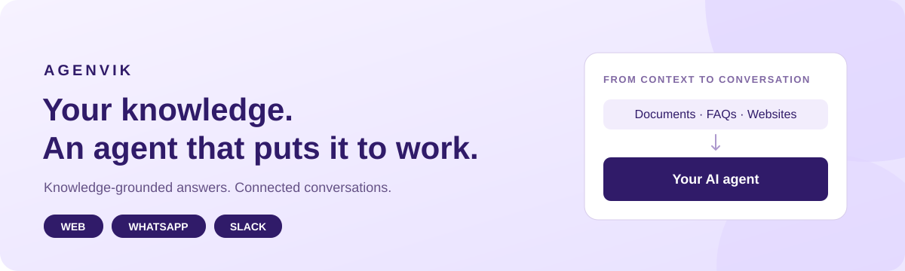
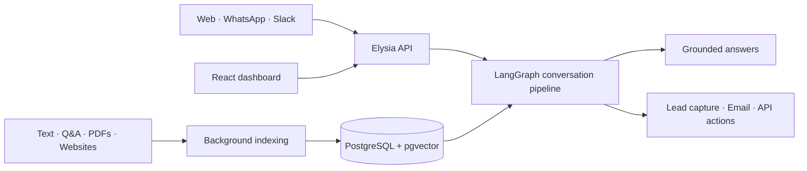

# Agenvik

<p align="center">
  
</p>

<p align="center">
  <strong>Turn your knowledge base into an AI agent.</strong><br />
  Bring your documents, configure the conversation, and connect the channels your customers use.
</p>

<p align="center">
  <a href="LICENSE"></a>
  
  
  
</p>

<p align="center">
  <a href="https://agenvik.com">Website</a> ·
  <a href="https://agenvik.com/docs">Product docs</a> ·
  <a href="#run-locally">Run locally</a> ·
  <a href="CONTRIBUTING.md">Contribute</a> ·
  <a href="CHANGELOG.md">Changelog</a>
</p>

## What is Agenvik?

Agenvik is an AI agent platform with a visual dashboard, a retrieval pipeline, and integrations for web chat, WhatsApp, and Slack. Add knowledge from text, Q&A, PDFs, or website content; configure the agent's behavior; then manage conversations and leads in one workspace.

This repository contains the backend, dashboard, chat client, embed loader, marketing site, and documentation. It is a Bun and Turborepo monorepo written primarily in TypeScript. The repository and shared package names retain **KnowBase**, the project's original name.

**Project status:** actively developed. Some capabilities require feature flags, a paid plan, or external provider setup. The hosted product at [agenvik.com](https://agenvik.com) and your own deployment have separate configuration and operating costs. See [Security](SECURITY.md) before exposing a deployment to users.

## What you can build

| Capability | What it does |
| --- | --- |
| Knowledge-grounded answers | Index text, Q&A, PDFs, and website content with OpenAI embeddings and pgvector retrieval. |
| Multi-channel agents | Use a web widget, connect a WhatsApp business number, or install a Slack integration. |
| Intent-based actions | Collect lead details, send email, and call configured APIs through the LangGraph conversation pipeline. |
| Conversation workspace | Review threads, captured leads, agent activity, and usage from the dashboard. |
| Agent customization | Set prompts, tone, fallback behavior, guardrails, and web widget colors. |
| Analytics and billing | Track message volume, topics, sentiment, and model costs; manage plan limits and subscription providers. |

Examples include a support assistant grounded in product documentation, a property enquiry agent on WhatsApp, or a Slack assistant for an internal handbook. [Product guides](https://agenvik.com/docs) explain the configuration available in the hosted product.

## How it works



The API handles agent configuration and chat requests. BullMQ workers process indexing and email jobs through Redis. LangGraph routes conversation turns through retrieval or intent handling, while PostgreSQL stores application data and conversation checkpoints.

## Tech stack

| Layer | Technologies |
| --- | --- |
| Backend | Bun, Elysia, Zod, TypeScript |
| AI and orchestration | LangGraph, LangChain, OpenAI, Vercel AI SDK |
| Storage and jobs | PostgreSQL, pgvector, Drizzle ORM, Redis, BullMQ |
| Dashboard and widget | React 19, Vite, TanStack Router and Query, Zustand |
| UI | Tailwind CSS, Radix UI, TipTap, Recharts |
| Website and docs | Astro, MDX, Mintlify |
| External services | Clerk authentication, Resend email, Razorpay or Kelviq billing |
| Workspace tooling | Bun workspaces, Turborepo, Biome |

## Run locally

### 1. Prepare your environment

You need:

- **Bun 1.2.12 or newer**; the repository declares `bun@1.2.12` as its package manager.
- **Node.js 22.12 or newer** for frontend tooling.
- **PostgreSQL with pgvector** and a database you can migrate.
- **Redis** for queues and caches.
- Development accounts and keys for **OpenAI** and **Clerk**. Enable Clerk organizations for dashboard access.

Use a development database and provider accounts. Local chat and indexing make billable OpenAI requests; the repository does not include an offline model or bundled authentication service.

```bash
git clone https://github.com/binarydiaries/knowbase.git
cd knowbase
bun install --frozen-lockfile

cp apps/backend/.env.example apps/backend/.env
cp apps/dashboard/.env.example apps/dashboard/.env
cp apps/client/.env.example apps/client/.env
cp apps/embed/.env.example apps/embed/.env
cp apps/landing/.env.example apps/landing/.env
```

### 2. Configure the core apps

Edit the copied files. These are the main settings for a local web-chat setup:

| File | Setting | Local value or purpose |
| --- | --- | --- |
| `apps/backend/.env` | `DATABASE_URL` | Connection string for your development PostgreSQL database. |
| | `REDIS_URL` | Redis connection, for example `redis://localhost:6379`. |
| | `OPENAI_API_KEY` | Your development OpenAI API key. |
| | `CLERK_PUBLISHABLE_KEY`, `CLERK_SECRET_KEY` | Keys from the same Clerk development instance. |
| | `TOKEN_ENCRYPTION_KEY` | A random 32-byte encryption key encoded as 64 hex characters. |
| | `ALLOWED_ORIGINS` | `http://localhost:4000,http://localhost:4001,http://localhost:4321,http://localhost:4173` |
| | `APP_URL`, `API_BASE` | `http://localhost:4001`, `http://localhost:3000` |
| `apps/dashboard/.env` | `VITE_API_BASE` | `http://localhost:3000` |
| | `VITE_CLERK_PUBLISHABLE_KEY` | The matching Clerk publishable key. |
| | `VITE_EMBED_BASE` | `http://localhost:4173` |
| `apps/client/.env` | `VITE_API_BASE` | `http://localhost:3000` |
| `apps/embed/.env` | `VITE_CLIENT_BASE` | `http://localhost:4000` |

Generate the encryption key locally and paste the result into the backend environment file:

```bash
openssl rand -hex 32
```

Keep the key stable for an existing database: changing it prevents decryption of integration tokens encrypted with the old key. Never put secrets in `VITE_` or `PUBLIC_` variables; those prefixes identify browser-visible configuration.

The remaining settings in the [backend example](apps/backend/.env.example) enable optional email, billing, Slack, WhatsApp, and monitoring integrations. Configure those services only when you need them. See the [landing app guide](apps/landing/README.md) to run the website independently.

### 3. Prepare the database

Enable pgvector in your development database before running migrations. Set the same `DATABASE_URL` in your shell for the `psql` command, or use your database administration tool:

```bash
psql "$DATABASE_URL" -c 'CREATE EXTENSION IF NOT EXISTS vector;'
bun run --cwd apps/backend db:migrate
```

The API also initializes LangGraph checkpoint tables on startup. Its database role needs permission to create those tables for a fresh installation.

### 4. Start the apps

Run each command in a separate terminal from the repository root:

```bash
bun run --cwd apps/backend dev     # API plus indexing and email workers
bun run --cwd apps/dashboard dev   # http://localhost:4001
bun run --cwd apps/client dev      # http://localhost:4000
```

For the embed loader, build once and serve the result:

```bash
bun run build:embed
bun run --cwd apps/embed dev       # http://localhost:4173
```

The API defaults to `http://localhost:3000`; its generated OpenAPI reference is at `/docs`. Sign in to the dashboard, create or select a Clerk organization, create an agent, add knowledge, and run indexing before testing knowledge-grounded replies. Configure the web channel and copy its channel ID for the embed.

### Embed your agent

```html
<script>
  window.AgenvikChat = {
    channelId: "YOUR_WEB_CHANNEL_ID",
    primaryColor: "#301B69"
  };
</script>
<script src="https://embed.agenvik.com/embed.js" defer></script>
```

For your own deployment, serve the bundle built from `apps/embed` and replace the script URL with your own. Set `VITE_CLIENT_BASE` before building it. See the [embed guide](apps/embed/README.md) and [installation docs](https://agenvik.com/docs/developer-guide/install-web-widget).

## Repository map

```text
apps/
  backend/     Elysia API, LangGraph pipeline, Drizzle schema, BullMQ workers
  dashboard/   Agent builder, conversation inbox, analytics, integrations, billing
  client/      Customer-facing React chat client, loaded in an iframe
  embed/       Script loader, launcher, iframe, and page messaging
  landing/     Astro marketing website and blog
  docs/        Mintlify product and developer guides
packages/
  ui/          Shared React components and editor (@knowbase/ui)
datasets/      Agenvik demo-agent knowledge content
docs/          Project notes, content plans, and website copy
```

## Development commands

Run these from the repository root:

| Command | Purpose |
| --- | --- |
| `bun run dev` | Start workspace development tasks; configure the apps you intend to run first. |
| `bun run build:dashboard` | Type-check and build the dashboard. |
| `bun run build:client` | Type-check and build the chat client. |
| `bun run build:landing` | Build the Astro website. |
| `bun run build:embed` | Build the distributable `embed.js`. |
| `bun run lint` | Check supported files with Biome. |
| `bun run lint:fix` | Apply Biome fixes; review the resulting diff. |

There is no complete automated application test suite yet. The backend test command is a placeholder, and the root `check-types` task currently has no workspace implementations. Use the relevant builds and the checks described in [CONTRIBUTING.md](CONTRIBUTING.md); describe any verification gaps in your pull request.

## Feature flags

Optional capabilities use runtime flags, with global defaults and organization overrides. A flag absent from the database resolves to `false`. An administrator can manage definitions and overrides under **Admin → System → Feature Flags**; configure backend `ADMIN_USER_IDS` or `ADMIN_EMAILS` to grant platform-admin access.

| Flag | Capability |
| --- | --- |
| `url_crawling` | Website content as a knowledge source. |
| `lead_generation` | Lead capture actions. |
| `api_call_action` | Configured API actions; plan restrictions also apply. |
| `whatsapp` | WhatsApp integration controls in the dashboard. |
| `slack` | Slack integration controls in the dashboard. |

Flags and plan limits are separate controls. Enabling a dashboard option does not replace provider setup or backend access checks.

## Contribute

Start with the [contribution guide](CONTRIBUTING.md). Report reproducible bugs or propose improvements through [GitHub issues](https://github.com/binarydiaries/knowbase/issues). Documentation, accessibility, integration improvements, and meaningful regression tests are useful places to help.

Please follow the [code of conduct](CODE_OF_CONDUCT.md) and report vulnerabilities privately through [SECURITY.md](SECURITY.md).

## License

Agenvik is distributed under the [MIT license](LICENSE). Existing third-party notices, including the Mintlify documentation starter's license, remain in place; see [third-party notices](THIRD_PARTY_NOTICES.md).
